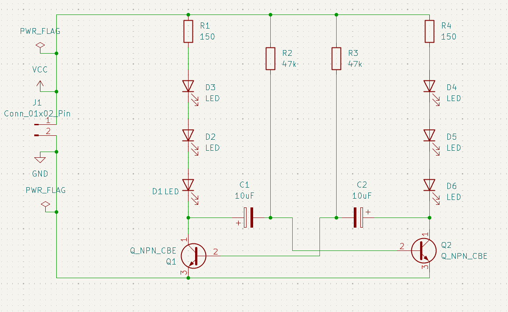
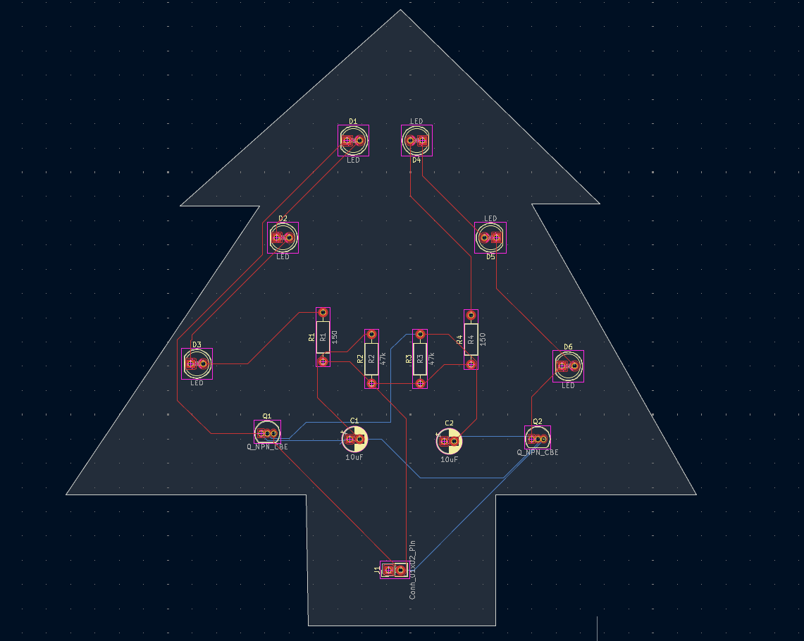
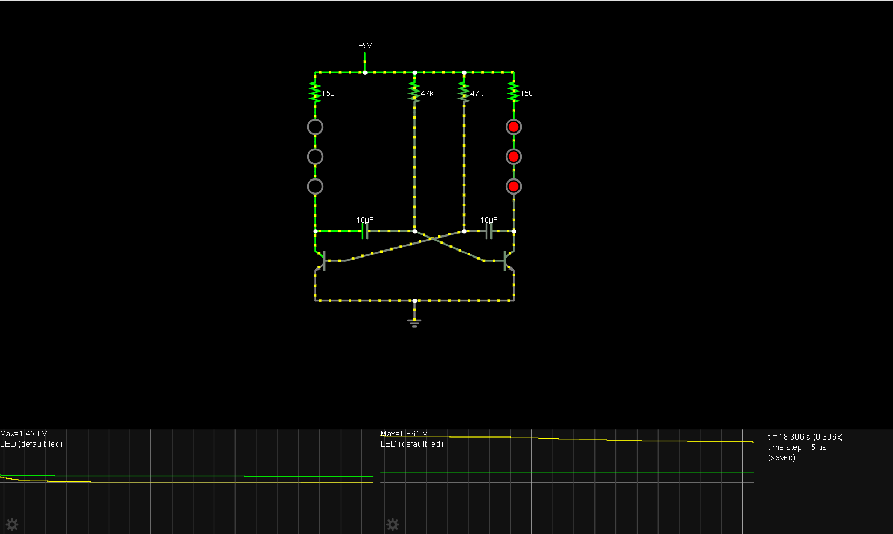

# Новорічна LED-ялинка (симетричний мультивібратор)

Проєкт розроблено в межах проєктної роботи з дисципліни "Проєктна робота в СКБ «Sky»"

## Опис пристрою
Схема побудована на базі класичного симетричного мультивібратора на двох NPN-транзисторах, що забезпечує почергове миготіння двох груп світлодіодів (по 3 світлодіоди на кожній гілці ялинки). Живлення здійснюється від батареї 9V («Крона») через двоконтактний роз'єм `J1`.

## Структура репозиторію
* `/KiCad` — принципова схема (`.kicad_sch`), трасування друкованої плати (`.kicad_pcb`) та 3D-модель плати (`.step`).
* `/Fusion 360` — 3D-модель підставки з нішею під батарею живлення, пазом під плату та фінальна збірка (`.f3z`, `.step`).
* `/Images` — візуалізація всіх етапів розробки.

## Етапи розробки

### 1. Принципова електрична схема (KiCad)
Виконано розрахунок та з'єднання елементів симетричного мультивібратора, перевірено відсутність помилок (ERC).

### 2. Трасування друкованої плати (KiCad PCB)
Створено фігурний контур плати у формі ялинки (`Edge.Cuts`), виконано двошарове розведення доріжок (`F.Cu` та `B.Cu`). Перевірка DRC пройдена з результатом `0 errors`, `0 unconnected items`.

### 3. 3D-візуалізація плати (KiCad 3D Viewer)

### 4. Корпус-підставка та фінальна збірка (Fusion 360)
Спроєктовано підставку з фасками, посадковим пазом під стовбур плати, відсіком для батареї 9V та отвором для виводу дротів живлення. Виконано фінальне складання конструкції.

### 5. Симуляція роботи симетричного мультивібратора (Falstad)
Для підтвердження працездатності схеми проведено моделювання у симуляторі [Falstad Circuit Simulator]([https://www.falstad.com/circuit/](https://www.falstad.com/breakout/circuitjs1-analog/circuitjs.html?ctz=DwYwlgTgBAZgvAIgIwKgFwM6IAwDpsEECsqYIiAzABwBMuA7AGw1G1IAsFAnF9o+6hAAjSjVQAHEQiLZUANwiISUALaYlAUwC0SFAD4AUFCjAASlAAeiGu2xRdNKDbv9U8BLKgB3d55UBDCzlELgQAekNjYC9La1t7JEckRjsHNxxwyJMYqwRnBMcKGlTE9I9Mo2zYhCKSx1s6stkIyujqhoKodipG2AyWqOhc5Lr7FPsmJtRFZBkKwerazqWkSb7yqBn2ekJ5kyHEDocuggnGKc3DnYI94AOEbtHHs4uZpDmBkwAZAFEAEWqIzOYzsNBsZTEqgA9ogACYaGD+ACuABs0FoURpYYI3oIAOYZKDCQkqITkDz4FCfYC-AHDcZg9ggpz0SHuSEqGEIeGI1HozHYom4okEjbEjak8l4bBUrI0-6Ahms5m1CGoTlwhHItEYrE4xAoEWE8V+Mk4Sm3WntHrA56MtXQzW8nUC-XIfHGqSmqUW6lW3J2mxdG00VkOjXcrV83WCkDCkCizwm9Vmikyy0KgMh5XPVXrDlcnna-l6oUGj1ir0pn3p6k5A3jFaNxhUKZ1612Ja5lttuUgRWdltQJYUHvrJPmwjpqBgYJp6cYGaeOSww74Lj8bCsZisbBURgUEjU-tZwdUE5ni41wiG2eThdL+Srh64Gi6UdIKi0IjsIj0Cj0Lc9Y1MUwIjmOvhAe0pyrIwF7DhB-RysB4Hnpw9TJL2rTAR0o7nsUaGYeOtxoNUBFdMkzLsERkFQOIAB25ZQEIGgGjcjqRs6aDyAAQj8iBaOw+D0FwVAUNgFDbOwxRFAIUByDxADCAlULgVBEGCXDsNp-70PQVBaSR7RFBRcHPNR5zEXRjHusxrHIOxEZFnyvH8RSjBMFutAAQBHl8BQvHKRSP6-jQflgkQiRcAF7b0meVHsZBsWHDaeHBnYDRYVEwFAuhVE9FlVSnl0JnmQVxHJcg4y5qBjyFW0uRdjaZWeElcp4ostWpaBkVskhrRQlAGg2aEUAYOIiCuOsFgBXRGRZFE4jyYSGDkkgzQLSYS1zrNq2TiwtxhFCcqDcNBqQuNk1ye4M0SOWm3ANtK1rRtlSLctNSoHtaYHdSR2GMAYTgBAhhAA)) з реальними номіналами елементів (`VCC = 9 В`, `R1 = R4 = 150 Ом`, `R2 = R3 = 47 кОм`, `C1 = C2 = 10 мкФ`). 

Під час симуляції гілки світлодіодів `D1–D3` та `D4–D6` почергово перемикаються у протифазі (коли ліва гілка відкрита та світиться, права — закрита, і навпаки). Теоретичний період повного циклу перемикання становить:

$$T \approx 0.7 \cdot (R_2 C_1 + R_3 C_2) = 0.7 \cdot (47\cdot 10^3 \cdot 10\cdot 10^{-6} + 47\cdot 10^3 \cdot 10\cdot 10^{-6}) \approx 0.66\text{ с}$$

*(Частота блимання кожної гілки — близько **1.5 Гц**).*

