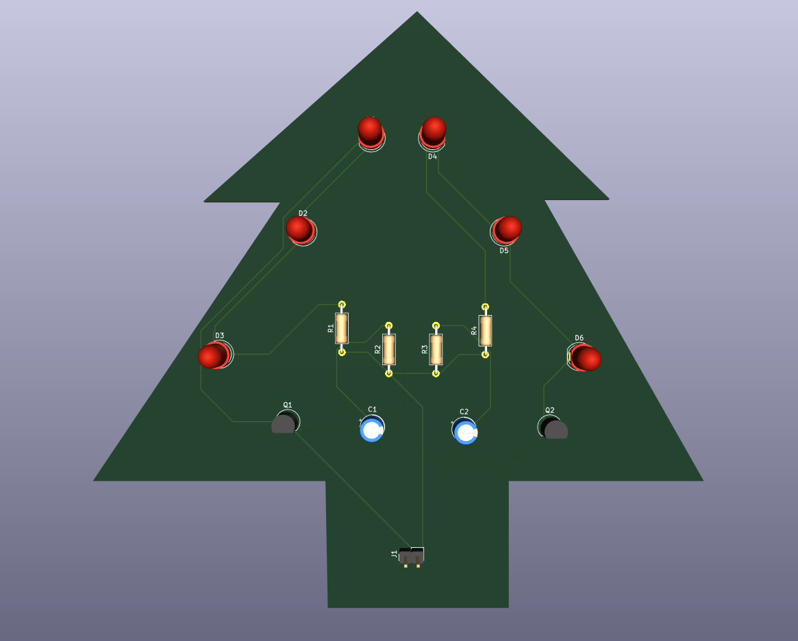
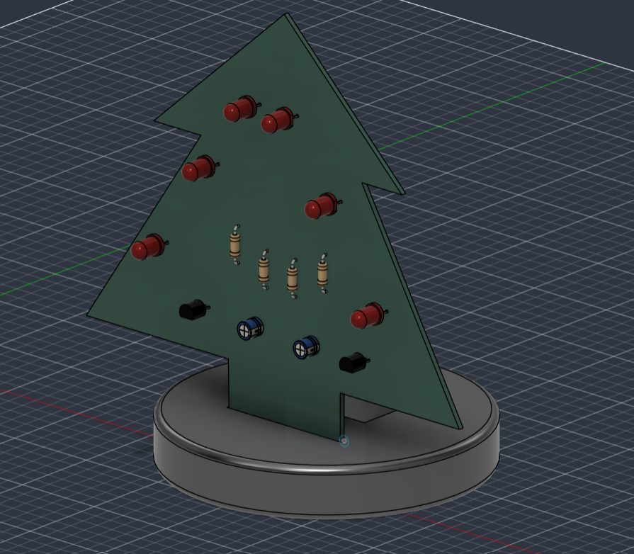

# Новорічна LED-ялинка (симетричний мультивібратор)

Проєкт розроблено в межах проєктної роботи з дисципліни "Проєктна робота в СКБ «Sky»"

## Опис пристрою
Схема побудована на базі класичного симетричного мультивібратора на двох NPN-транзисторах, що забезпечує почергове миготіння двох груп світлодіодів (по 3 світлодіоди на кожній гілці ялинки). Живлення здійснюється від батареї 9V («Крона») через двоконтактний роз'єм `J1`.

## Структура репозиторію
* `/KiCad` — принципова схема (`.kicad_sch`), трасування друкованої плати (`.kicad_pcb`) та 3D-модель плати (`.step`).
* `/Fusion 360` — 3D-модель підставки з нішею під батарею живлення, пазом під плату та фінальна збірка (`.f3z`, `.step`).
* `/Images` — візуалізація всіх етапів розробки.

## Етапи розробки

### 1. Принципова електрична схема (KiCad)
Виконано розрахунок та з'єднання елементів симетричного мультивібратора, перевірено відсутність помилок (ERC).

### 2. Трасування друкованої плати (KiCad PCB)
Створено фігурний контур плати у формі ялинки (`Edge.Cuts`), виконано двошарове розведення доріжок (`F.Cu` та `B.Cu`). Перевірка DRC пройдена з результатом `0 errors`, `0 unconnected items`.

### 3. 3D-візуалізація плати (KiCad 3D Viewer)

### 4. Корпус-підставка та фінальна збірка (Fusion 360)
Спроєктовано підставку з фасками, посадковим пазом під стовбур плати, відсіком для батареї 9V та отвором для виводу дротів живлення. Виконано фінальне складання конструкції.

